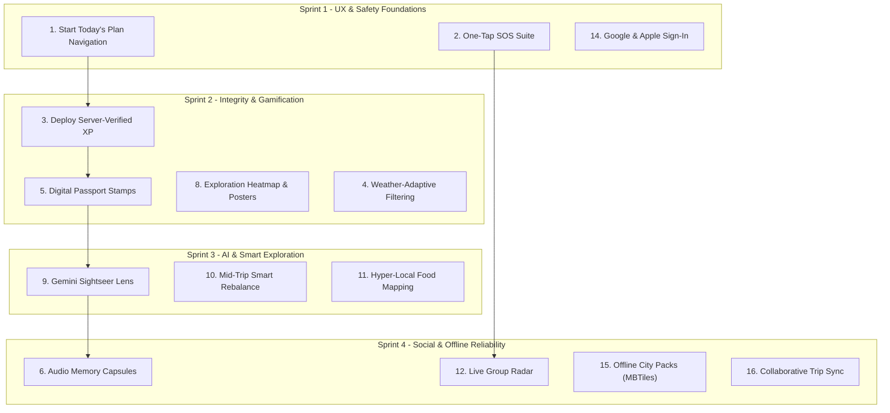

# Tabi: Upcoming Features & Detailed Technical Roadmap

Comprehensive engineering specifications, architectural designs, data schemas, and implementation checklists for all 16 upcoming features for the **Tabi** exploration platform.

---

## Roadmap & Prioritization Matrix

| # | Feature | Category | Impact | Complexity | Dependencies |
|---|---|---|---|---|---|
| **1** | **Start Today's Plan (Planner $\rightarrow$ Tracking)** | Workflow | 🟢 High | 🟡 Medium | `directions_service.dart`, `tracking_screen.dart` |
| **2** | **One-Tap SOS & Emergency Safety Suite** | Safety | 🟢 High | 🟢 Low | `geolocator`, `url_launcher` |
| **3** | **Server-Verified XP & Cloud Anti-Cheat** | Integrity | 🟢 High | 🟡 Medium | Firebase Blaze, `functions/index.js`, `firestore.rules` |
| **4** | **Weather-Adaptive Discovery & Environmental Safety** | Discovery | 🟡 Medium | 🟢 Low | `weather_service.dart`, Open-Meteo |
| **5** | **Digital Passport Stamps & Regional Collectibles** | Gamification | 🟢 High | 🟡 Medium | SQLite `adventures`, `locations`, SVG/Canvas |
| **6** | **Audio Memory Capsules (Geocached Capsules)** | Social/Hook | 🟢 High | 🔴 High | `memories_api`, `record`, `audioplayers` |
| **7** | **AR Wayfinder / Camera Compass Mode** | Immersion | 🟡 Medium | 🔴 High | `camera`, `sensors_plus` / magnetometer |
| **8** | **Personal Exploration Heatmap & Poster Export** | Virality | 🟢 High | 🟡 Medium | `route_points`, `flutter_map`, `screenshot` |
| **9** | **Gemini Sightseer Lens (Monument Recognition)** | AI | 🟢 High | 🟡 Medium | `google_generative_ai` (Gemini Vision) |
| **10** | **Mid-Trip "Smart Rebalance"** | AI | 🟡 Medium | 🟡 Medium | `trip_planner_service.dart`, Gemini API |
| **11** | **Hyper-Local Food & Specialty Mapping** | AI/Content | 🟡 Medium | 🟢 Low | `nearby_places_service.dart`, Overpass API |
| **12** | **Live Group Radar & Synchronized Trekking** | Social | 🟢 High | 🔴 High | Firestore `group_adventures`, background GPS |
| **13** | **Community Curated Walking Tours** | Social | 🟢 High | 🟡 Medium | Firestore `curated_tours`, `adventures` |
| **14** | **OAuth Sign-In (Google & Apple)** | Auth/Growth | 🟢 High | 🟢 Low | `google_sign_in`, `sign_in_with_apple` |
| **15** | **Offline City Packs (MBTiles & Offline Cache)** | Offline | 🟢 High | 🔴 High | `flutter_map_mbtiles`, SQLite storage |
| **16** | **Live Multi-User Trip Plan Sync (Stop-Level CRDT)** | Social | 🟡 Medium | 🟡 Medium | Firestore `trip_plans` collection |

---

## 1. Workflow & Safety Foundations

### Feature 1: "Start Today's Plan" (Trip Planner to Live Tracking Integration)

#### Overview & User Experience
Users generate multi-day itineraries in the AI Trip Planner. Currently, plans sit as static itinerary screens. "Start Today's Plan" turns an entire day's stops into an active multi-checkpoint trek:
1. User taps **"Start Day 1"** on the Itinerary screen (`/itinerary/:id`).
2. The app initializes an `AdventureSession` populated with an ordered sequence of `Checkpoints`, pre-computing the TSP/car/walking route between them.
3. Live Tracking launches with a top navigation card: *"Stop 1 of 4: Kashi Vishwanath Temple (1.2 km away)"*.
4. Arriving within 40m triggers the proof-photo shutter. Capturing the photo completes Stop 1, awards place XP, and automatically re-routes directions to Stop 2.
5. Finishing the day summarizes the total stops visited, aggregate trek km, and marks the day completed in the saved trip plan.

#### Current Codebase Foundation
* Planner: `lib/features/planner/presentation/itinerary_detail_screen.dart`, `lib/features/planner/data/trip_plan.dart`.
* Tracking: `lib/features/tracking/presentation/tracking_screen.dart`, `lib/features/tracking/domain/adventure_session.dart`, `lib/features/tracking/domain/checkpoint.dart`.
* Routing: `lib/features/tracking/data/directions_service.dart` (FOSSGIS / OSRM router).

#### Technical Architecture & Data Design
* **Session Model Enhancement:**
  ```dart
  class AdventureSession {
    final String? sourcePlanId;
    final int? planDayIndex;
    final List<Checkpoint> chainedStops;
    int currentStopIndex;
    // existing fields...
  }
  ```
* **Database Updates (`real_world_exploration.db`):**
  * Add `plan_id TEXT` and `plan_day INTEGER` columns to `adventures` table.
  * In `trip_plans.json`, mark `stops[i].completedAt = ISO8601` when checkpoint is verified.
* **UI Component:** `ChainedRouteHeader` showing a horizontal progress bar of checkpoints (green = visited, pulsing amber = current target, grey = pending).

#### Edge Cases & Anti-Cheat
* **Skipping a stop:** If a monument is closed or crowded, provide a "Skip to next stop" button (awards 0 place XP for that stop, but keeps the trek alive).
* **Out of order visits:** If GPS detects arrival at Stop 3 before Stop 2, prompt: *"Arrived at Dashashwamedh Ghat early! Switch to this checkpoint?"*.

#### Task Checklist
- [ ] Add `planId` and `dayIndex` query params to `/tracking` route in `app_router.dart`.
- [ ] Implement `TrackingService.startChainedPlanDay(TripPlan plan, int dayIndex)`.
- [ ] Create `ChainedRouteHeader` widget on `tracking_screen.dart`.
- [ ] Link proof-photo arrival confirmation to advance `currentStopIndex`.
- [ ] Update local `trip_plans` row in SQLite upon completion.

---

### Feature 2: One-Tap SOS & Emergency Safety Suite

#### Overview & User Experience
Exploration often leads users into unfamiliar alleys, remote trails, or solo night walks.
1. During any active trip (or from the profile/home quick actions), a prominent **SOS Button** is accessible.
2. Long-pressing the SOS button (2-second hold to avoid accidental triggers):
   - Immediately generates a distress payload: current GPS coordinates, accuracy, battery percentage, nearest reverse-geocoded address, and a live OpenStreetMap tracking link.
   - Opens the native SMS/WhatsApp dispatcher pre-filled to designated emergency contacts.
   - Triggers an optional loud audible siren (toggleable).
3. Displays a persistent safety card with one-touch dialing for national and local emergency numbers across India.

#### Current Codebase Foundation
* Stored Preferences: `lib/features/preferences/data/preferences_service.dart`.
* Location: `lib/core/services/location_service.dart`.
* Missing: SMS dispatch, emergency contacts storage, national directory.

#### Technical Architecture & Data Design
* **Emergency Contacts Storage:**
  Stored in `SharedPreferences` as `emergency_contacts_v1`:
  ```json
  [
    {"name": "Priya (Sister)", "phone": "+919876543210", "relationship": "Family"},
    {"name": "Amit (Friend)", "phone": "+919812345678", "relationship": "Friend"}
  ]
  ```
* **Emergency Directory Data (`assets/data/emergency_helplines_india.json`):**
  * National Emergency: `112`
  * Police: `100` / `112`
  * Ambulance: `108` / `102`
  * Women Helpline: `1091` / `181`
  * Tourist Police Helpline: `1363`
  * Mountain Rescue / Disaster Management (NDRF): `1078`
* **Dispatch URL:**
  Using `url_launcher`: `sms:+919876543210?body=EMERGENCY! I need help. My live location: https://www.openstreetmap.org/?mlat=25.3176&mlon=82.9739#map=17/25.3176/82.9739 (Battery: 18%)`.

#### Edge Cases & Offline Handling
* **No cellular data:** SMS does not require mobile internet, only cellular network signal. Coordinates and battery are generated purely on-device.
* **No GPS lock:** Fall back to the last known position cached by `LocationService` with a timestamp: *"Last known location (5 mins ago): ..."*.

#### Task Checklist
- [ ] Create `EmergencyContactsScreen` in `lib/features/preferences/presentation/`.
- [ ] Build `SosFloatingButton` with 2-second vibration feedback and confirmation dialog.
- [ ] Build `EmergencyDirectorySheet` with quick-dial buttons for 112, 108, 1091, 1363.
- [ ] Integrate SMS URL launcher payload builder in `lib/core/services/emergency_service.dart`.

---

### Feature 3: Server-Verified XP & Cloud Anti-Cheat Activation

#### Overview & User Experience
The app currently records GPS fixes, steps, and photos, and verifies them locally via `TripGuard`. However, modified APKs can falsify local SQLite tables. Server verification shifts trust to Firebase:
1. When a trip completes, `TripRecorder` packs all collected GPS fixes (timestamp, lat, lng, speed, accuracy, mock flag), pedometer steps, and the proof photo URI.
2. The payload is sent to the Cloud Function `verifyTrip` (`asia-south1`).
3. The Cloud Function independently replays the trip, validates speed thresholds, ensures $\ge 60\%$ travel share, verifies photo timestamp and EXIF, checks 7-day place cooldown, and writes directly to `verified_xp/{uid}`.
4. The client receives a cryptographic verification receipt.
5. The global Leaderboard and Passport ranks display `verified_xp`.

#### Current Codebase Foundation
* Server code already written: `functions/index.js`, `functions/lib/trip_guard.js`, `functions/lib/trip_split.js`.
* Firestore rules ready: `firestore.rules` (defines `verified_xp/{uid}` as read-only for clients).
* Tests passing: `functions/test/*.test.js` (72 tests passing).
* Feature flag: `lib/core/config/feature_flags.dart` (`serverVerifiedXp = false`).

#### Deployment & Activation Blueprint
1. **Firebase Deployment:**
   ```bash
   firebase login
   firebase deploy --only functions:verifyTrip,firestore:rules
   ```
2. **App Check Setup:**
   Enable Firebase App Check with Play Integrity (Android) and DeviceCheck/App Attest (iOS) to ensure only genuine unmodified app instances call the Cloud Function.
3. **Leaderboard Redirection:**
   Update `lib/features/social/domain/leaderboard.dart` to query `collection('verified_xp').orderBy('totalXp', descending: true)` instead of `explorers/{uid}.totalXp`.

#### Task Checklist
- [ ] Deploy Cloud Functions to Firebase project (`clone-2353a` or production).
- [ ] Deploy updated `firestore.rules`.
- [ ] Switch `FeatureFlags.serverVerifiedXp = true`.
- [ ] Update `LeaderboardRepository` to consume `verified_xp`.
- [ ] Add a "Verified Explorer" badge (shield icon) next to user names on the leaderboard.

---

### Feature 4: Weather-Adaptive Discovery & Environmental Safety

#### Overview & User Experience
India experiences extreme microclimates—monsoon flash floods, 45°C summers, and severe winter smog (AQI 400+).
1. On the Explore and City Detail screens, places are tagged with environmental flags: `outdoor_exposed`, `indoor_sheltered`, `water_adjacent`, `high_altitude`.
2. When the user opens the app or views a city, `WeatherService` fetches current temperature, precipitation probability, wind speed, UV index, and AQI (via Open-Meteo Air Quality API).
3. If bad weather is detected:
   - Severe rain/thunderstorm: Displays banner *"Heavy rain in Varanasi. Showing sheltered temples, museums, and cafes"*.
   - High AQI (>250): Advises morning indoor walks or masks; dampens trekking XP decay.
   - Extreme heat (>40°C between 12 PM - 4 PM): Warns against exposed treks; prioritizes morning/sunset quests.

#### Technical Architecture
* **API Extension:** Query Open-Meteo Air Quality endpoint:
  `https://air-quality-api.open-meteo.com/v1/air-quality?latitude=...&longitude=...&current=pm2_5,pm10,european_aqi`
* **Filtering Logic (`lib/features/locations/data/nearby_places_service.dart`):**
  ```dart
  bool isPlaceSafeUnderCurrentWeather(Location place, WeatherData weather) {
    if (weather.isSevereRain && place.category == PlaceCategory.viewpoint) return false;
    if (weather.temperature > 40.0 && place.isExposedOutdoor) return false;
    return true;
  }
  ```
* **UI Indicator:** Weather pill on `PlaceCard`: "☀️ Best before 11 AM", "☔ Sheltered indoor", "⚠️ AQI 320 - Mask Recommended".

#### Task Checklist
- [ ] Add AQI and UV index parsing to `WeatherData` model in `lib/features/weather/domain/weather.dart`.
- [ ] Add `isIndoor` and `exposureType` attributes to `Location` entity.
- [ ] Implement filter chip *"Good for Current Weather"* on City Detail and Explore screens.
- [ ] Show temperature & weather advisory badge inside `StartAdventureView`.

---

## 2. Exploration & Gamification

### Feature 5: Digital Passport Stamps & Regional Collectibles

#### Overview & User Experience
Inspired by physical national park passports and vintage international visa stamps:
1. Reaching a milestone or completing a city trek awards an intricately designed digital stamp.
2. Each stamp is uniquely stylized based on regional heritage:
   - *Varanasi*: Brass-embossed Ghat silhouette with Sanskrit motto.
   - *Jaipur*: Rajasthani archway with royal pink ink and block-print borders.
   - *Manali / Ladakh*: Mountain contours with prayer wheel iconography.
   - *Goa*: Coastal palm seal with Portuguese maritime crest.
3. Stamps record: Date visited, trek distance, elevation, and unique explorer serial number (`#00482`).
4. Users can open their "Passport Book", flip through realistic textured pages, and tap **"Share Passport Page"** to render an Instagram-story/WhatsApp card.

#### Technical Architecture & Data Design
* **SQLite Table (`passport_stamps`):**
  ```sql
  CREATE TABLE passport_stamps (
    id TEXT PRIMARY KEY,
    city_id TEXT NOT NULL,
    city_name TEXT NOT NULL,
    stamp_code TEXT NOT NULL,
    earned_at TEXT NOT NULL,
    adventure_id TEXT,
    trek_distance_meters REAL,
    image_asset_path TEXT NOT NULL
  );
  ```
* **Stamp Generation & Rendering:**
  * Base vector assets in `assets/stamps/{city_code}.svg`.
  * Dynamic canvas layer rendering the user's visit date, coordinates, and serial number over the SVG using `CustomPainter`.
  * Export to PNG using `RenderRepaintBoundary` for native sharing.

#### Task Checklist
- [ ] Create `passport_stamps` table in `database_service.dart`.
- [ ] Design SVG stamp templates for top 15 Indian exploration hubs (Delhi, Jaipur, Agra, Varanasi, Amritsar, Mumbai, Goa, Hampi, Kochi, Udaipur, Manali, Rishikesh, Leh, Kolkata, Shillong).
- [ ] Build `PassportBookScreen` with page-flip animation.
- [ ] Build exportable `PassportStampCard` with social share action.

---

### Feature 6: Audio Memory Capsules (Geocached Time Capsules)

#### Overview & User Experience
Transforms the real world into an audible historical and personal tapestry:
1. While trekking at a location, an explorer can tap **"Leave an Audio Capsule"**.
2. They record a 30-to-60-second voice note: a local tip, historical legend, ghost story, or personal reflection.
3. They set visibility: **Public Explorer Network**, **Friends Only**, or **Private Memory**.
4. The capsule is anchored to the exact GPS coordinate $(\pm 25\text{ m})$.
5. When future explorers walk within 25m of that spot with Tabi open, their phone gently vibrates: *"🎧 Audio Capsule Nearby: 'The Secret Ghat of Assi' left by @aravind"*.
6. Tapping opens an audio player with spatial audio wave animation.

#### Technical Architecture & Storage
* **Backend Storage (`backend/server.js` & GridFS):**
  Audio files (`.m4a` / `.aac`, max 5 MB) stored via existing GridFS memories backend.
* **Geofence Indexing:**
  MongoDB 2dsphere index on `memories` collection:
  ```javascript
  db.memories.createIndex({ "geoPoint": "2dsphere" });
  ```
* **Client Proximity Service (`lib/features/memories/services/capsule_proximity_service.dart`):**
  * Checks distance between live GPS stream and cached local capsules every 15 seconds.
  * Plays gentle haptic feedback (`HapticFeedback.mediumImpact()`) on discovery.

#### Edge Cases & Anti-Spam
* **Content Moderation:** Audio capsules have a "Report Offensive Content" button. 3 community reports auto-quarantine the capsule.
* **Spam prevention:** User must be physically present at the coordinate (verified GPS reading under 90s) to plant a capsule. Maximum 2 capsules per user per landmark.

#### Task Checklist
- [ ] Add 2dsphere index to memories collection in `backend/server.js`.
- [ ] Build `AudioRecorderDialog` with live decibel waveform visualization.
- [ ] Implement `CapsuleProximityService` listening to `LocationService.positionStream`.
- [ ] Build floating "Capsule Unlocked" bottom sheet with audio playback controls.

---

### Feature 7: AR Wayfinder / Camera Compass Mode

#### Overview & User Experience
In medieval Indian street layouts (e.g., the winding *galis* of Old Delhi, Varanasi, or Jodhpur), 2D maps frequently suffer from GPS multipath reflection and heading confusion.
1. During live navigation, the user taps the **"AR View"** camera icon on the map.
2. The live camera feeds the screen with a semi-transparent HUD:
   - A floating 3D neon waypoint pin hovers over the physical street in the direction of the next checkpoint.
   - A real-time floating badge displays: *"Vishwanath Temple • 120m ahead"*.
   - A dynamic ground compass arrow rotates to match the user's azimuth.
3. Eliminates doubt about which fork or alleyway to take.

#### Technical Architecture
* **Sensors:** Combines `sensors_plus` (Magnetometer + Accelerometer for true north compass heading) with `geolocator` bearing calculation.
* **Bearing Calculation:**
  $$\theta = \text{atan2}(\sin(\Delta L)\cos(lat_2), \cos(lat_1)\sin(lat_2) - \sin(lat_1)\cos(lat_2)\cos(\Delta L))$$
* **HUD Overlay:** Flutter `CameraPreview` layered with a reactive `CustomPainter` that translates the difference between phone heading and target bearing into horizontal screen pixel displacement.

#### Edge Cases
* Magnetometer interference near heavy metal/vehicles: Display *"Calibrate compass by waving phone in figure 8"*.
* Battery saving: Auto-switches back to map after 90 seconds of inactivity.

#### Task Checklist
- [ ] Integrate magnetometer stream in `lib/core/services/compass_service.dart`.
- [ ] Create `ArNavigationScreen` with `camera` preview overlay.
- [ ] Calculate relative screen horizontal offset based on azimuth delta ($\Delta\theta$).
- [ ] Add smooth low-pass filter to prevent waypoint jitter.

---

### Feature 8: Personal Exploration Heatmap & Poster Generator

#### Overview & User Experience
Users take pride in their cumulative travel footprint.
1. In the Journal / Profile screen, users tap **"My World Heatmap"**.
2. An interactive dark-mode map displays all recorded GPS routes (`route_points`) glowing like illuminated neon filaments over their city or state.
3. Tapping **"Create Poster"** opens a high-aesthetic poster generator:
   - Choice of palettes: *Midnight Obsidian*, *Cyberpunk Amber*, *Vintage Parchment*, *Emerald Forest*.
   - Embedded typography: Explorer name, Total km walked, Cities explored, Elevation climbed.
   - 1-tap export to high-res PNG (300 DPI) sized perfectly for phone wallpaper, Instagram post, or printing.

#### Technical Architecture
* **Data Source:** Query `route_points` joined with `adventures` where `status = 'completed'` and `trek_distance_meters > 200`.
* **Rasterization / Export:**
  * Wrapped in `RepaintBoundary`.
  * Custom shader / polyline renderer drawing glowing path widths inversely proportional to zoom.
  * Image captured using `ui.Image.toByteData(format: ui.ImageByteFormat.png)`.

#### Task Checklist
- [ ] Implement `HeatmapPolylineOverlay` on `flutter_map`.
- [ ] Build `PosterGeneratorScreen` with theme presets and typography overlays.
- [ ] Integrate `share_plus` to export image directly to system share sheet.

---

## 3. AI Travel Intelligence (Gemini)

### Feature 9: Gemini Sightseer Lens (Monument & Culture Recognition)

#### Overview & User Experience
Explorers regularly encounter ancient idols, temple carvings, fort ramparts, and inscriptions without any informative plaques.
1. Inside the app's camera, tap **"Sightseer Lens"**.
2. The user snaps a photo of an architectural structure, painting, or sculpture.
3. The image + current GPS coordinates are sent to Gemini 1.5 Flash (Vision).
4. Within 2 seconds, an interactive cultural card slides up:
   - **What it is:** *"11th Century Chola-style Nataraja Bronze"*.
   - **Historical context:** 2 concise paragraphs describing the dynasty, symbolism, and mythic backstory.
   - **Hidden details to spot:** 3 bullet points (e.g., *"Notice the demon of ignorance crushed beneath the right foot"*).
   - **Audio narration:** "Listen to story" (Text-to-Speech).

#### Technical Architecture
* **Prompt Engineering (`lib/features/ai/application/sightseer_lens_service.dart`):**
  ```dart
  final prompt = '''
  You are an expert Indian archaeologist and cultural historian.
  The user is at latitude: $lat, longitude: $lng (near $nearestLandmark).
  Analyze this photo. Identify the landmark, architectural style, historical era,
  and 3 fascinating hidden details an explorer should look for right now.
  Format strictly as JSON matching this schema: {...}
  ''';
  ```
* **Model:** `gemini-1.5-flash` with image bytes and strict JSON response schema.

#### Task Checklist
- [ ] Create `SightseerLensScreen` integrating live camera shutter with crop tool.
- [ ] Build `SightseerLensService` with Gemini Vision prompt and error handling.
- [ ] Design `CulturalFactSheet` with collapsible sections and text-to-speech integration.

---

### Feature 10: Mid-Trip "Smart Rebalance" (Dynamic Schedule Adaptation)

#### Overview & User Experience
Real-world travel rarely goes strictly according to plan.
1. A user is following Day 2 of their planned Varanasi trip. They spent an extra 2.5 hours enjoying boat rides at Assi Ghat, and it is now 4:30 PM.
2. The app detects the delay, or the user taps **"Adjust My Schedule"**.
3. User selects what happened: *"Running late"*, *"Monument closed"*, *"Feeling tired"*, or *"Caught in rain"*.
4. Gemini takes the remaining planned stops for the day, checks live sunset time and evening opening hours, and rewrites the remainder of Day 2:
   - Safely removes lower-priority stops.
   - Re-routes the evening to ensure they reach the Ganga Aarti on time at 6:30 PM.
   - Re-optimizes walking routes from their *current live GPS location*.

#### Technical Architecture
* **Input Payload:** Current GPS location, current local time, list of completed stop IDs, list of pending stops, user reason code.
* **Service:** `TripPlannerService.rebalanceDayItinerary(...)`.
* **Database:** In-place update to `trip_plans.plan_data` in SQLite and sync to Firestore.

#### Task Checklist
- [ ] Add "Rebalance Day" action button in `ItineraryDetailScreen`.
- [ ] Create `RebalanceOptionsSheet` (options: running late, tired, bad weather).
- [ ] Implement Gemini prompt with strict JSON schema for schedule compression.
- [ ] Seamlessly animate updated stops in the itinerary view.

---

### Feature 11: Hyper-Local Food & Specialty Mapping

#### Overview & User Experience
Food is an essential pillar of Indian travel.
1. Along any active trip route or city itinerary, display an optional **"Food & Craft Gems"** map layer.
2. Rather than generic restaurant listings, this surfaces iconic regional specialties tied to specific historic neighborhoods:
   - Near Dashashwamedh Ghat: *Kashi Chaat Bhandar (Tamatar Chaat)*, *Blue Lassi*.
   - In Old Delhi: *Daulat ki Chaat*, *Paranthe Wali Gali*.
   - In Amritsar: *Kesar Da Dhaba (Dal Makhani)*, *Gurdas Ram Jalebi*.
3. Each item has: Specialty dish name, veg/non-veg indicator, historical backstory (e.g., *"Serving since 1916"*), average price range (₹50–₹200), and best time to visit.

#### Technical Architecture
* **Overpass API Query:** Query OSM nodes with tags `amenity=fast_food`, `amenity=cafe`, `cuisine=*`, `historic=*`.
* **Curated Food Catalog:** Bundled JSON `assets/data/india_food_gems.json` for guaranteed authentic heritage eateries across top 30 cities.
* **UI Marker:** Distinct orange fork-and-spoon icon on the map with quick "Add as snack stop" action.

#### Task Checklist
- [ ] Build `assets/data/india_food_gems.json` with 250+ iconic regional street food stops.
- [ ] Add `FoodGem` domain model and filter toggle on `MapScreen`.
- [ ] Allow inserting a Food Gem into an active day plan as an afternoon snack checkpoint.

---

## 4. Social & Multiplayer

### Feature 12: Live Group Radar & Synchronized Trekking

#### Overview & User Experience
Trekking with friends, family, or tour groups often leads to people getting separated in crowded bazaars or forest trails.
1. Group Adventure participants tap **"Join Live Group Radar"**.
2. All members who opt-in have their live locations streamed to Firestore with 5-second throttling.
3. The map displays custom avatars for each friend:
   - Green ring = within 50m.
   - Amber ring = 50m - 150m away.
   - Pulsing Red alert = Straying > 150m from group leader.
4. Shows each member's live phone battery level (so you know if a lost friend's phone died).
5. Quick ping buttons: *"I'm stopping here for chai"*, *"Wait for me!"*, *"Regroup at leader"*.

#### Technical Architecture & Firestore Data Design
* **Firestore Collection (`group_adventures/{advId}/live_presence/{uid}`):**
  ```javascript
  {
    "uid": "user_xyz",
    "displayName": "Jatin",
    "avatarUrl": "https://...",
    "position": new GeoPoint(25.3176, 82.9739),
    "batteryPercent": 74,
    "lastSeen": FieldValue.serverTimestamp(),
    "statusNote": "At chai stall"
  }
  ```
* **Lifecycle & Security:** Presence documents have TTL / deleted automatically when user leaves or adventure ends.

#### Task Checklist
- [ ] Build `GroupRadarMapOverlay` listening to Firestore snapshot stream.
- [ ] Add battery monitoring via `battery_plus` package.
- [ ] Implement proximity separation alert banner when distance exceeds 150m.
- [ ] Add quick-ping action chips on the radar map view.

---

### Feature 13: Community Curated Walking Tours & Heritage Trails

#### Overview & User Experience
Empowers experienced local explorers to become creators:
1. An explorer who completed an exceptional walk (e.g., *"Secret Haveli Trail of Chandni Chowk"*) can tap **"Publish as Curated Tour"**.
2. They add photos, audio commentary per stop, estimated time, and walking tips.
3. Tours undergo automated checks (minimum 4 verified stops, verified trek km) and appear in the City Detail screen under **"Curated Community Tours"**.
4. Other travelers can rate, review, bookmark, and follow the exact trail.
5. Tour creators earn "Curator XP" and special profile badges (*"Master Heritage Guide"*).

#### Technical Architecture
* **Firestore Collection (`curated_tours/{tourId}`):**
  ```json
  {
    "creatorUid": "uid_123",
    "creatorName": "Rohan Sharma",
    "cityId": "in_delhi",
    "title": "Secret Havelis of Old Delhi",
    "stops": [
      {"name": "Haveli Dharampura", "lat": 28.6505, "lng": 77.2315, "tip": "Enter from lane 3"}
    ],
    "totalDistanceMeters": 3200,
    "completionCount": 84,
    "averageRating": 4.8
  }
  ```

#### Task Checklist
- [ ] Create `PublishTourScreen` allowing conversion of past completed adventure into a public tour.
- [ ] Add "Community Tours" carousel on `CityDetailScreen`.
- [ ] Build tour rating and review modal.

---

### Feature 14: OAuth Sign-In (Google & Apple Authentication)

#### Overview & User Experience
Email and password authentication introduces high friction during initial onboarding.
1. On `/login` and `/onboarding`, provide clean **"Continue with Google"** and **"Continue with Apple"** buttons.
2. 1-tap sign-in provisions the Firebase Auth account.
3. Automatically sets up the explorer profile in `explorers/{uid}` with their Google/Apple display name and profile picture avatar.
4. Auto-restores their cloud-synced trips and verified XP.

#### Technical Architecture
* **Packages:** `google_sign_in: ^6.2.1`, `sign_in_with_apple: ^6.1.0`.
* **Auth Service Flow (`lib/features/auth/data/auth_repository.dart`):**
  * Sign in with Google credential $\rightarrow$ Firebase `signInWithCredential`.
  * Check if `explorers/{uid}` exists in Firestore. If missing, initialize with `totalXp: 0`, `rank: 'Beginner'`.

#### Task Checklist
- [ ] Add `google_sign_in` and `sign_in_with_apple` to `pubspec.yaml`.
- [ ] Configure SHA-1 and SHA-256 fingerprints in Firebase Console.
- [ ] Update `LoginScreen` and `RegisterScreen` with social auth buttons.
- [ ] Ensure seamless fallback to offline anonymous guest mode if auth is dismissed.

---

## 5. Offline & Performance

### Feature 15: Offline City Packs (MBTiles & Offline Cache)

#### Overview & User Experience
Remote exploration in the Himalayas, Thar Desert, or Western Ghats frequently has zero cell reception.
1. On any City Detail screen (or in Settings $\rightarrow$ Offline Maps), users tap **"Download City Pack"** (e.g., *"Manali & Solang Valley • 48 MB"*).
2. The download bundles:
   - Vector or raster map tiles up to zoom level 16 in `.mbtiles` format.
   - Offline Wikipedia place summaries and coordinates.
   - Emergency contact numbers and offline directions routing graph.
3. When cell service drops, the map displays a discreet green badge: *"Offline Map Active"*, with seamless panning and zoom.

#### Technical Architecture
* **Tile Storage:** Pre-packaged MBTiles stored in app documents directory (`getApplicationDocumentsDirectory()`).
* **Tile Provider:** Integrate `flutter_map_mbtiles` with `flutter_map` fallback pipeline:
  1. Check local MBTiles SQLite file.
  2. If missing and online, fetch from OSM tile server and write to file cache.
  3. If offline and missing, show clean vector grid placeholder.

#### Task Checklist
- [ ] Add `flutter_map_mbtiles: ^3.1.0` to `pubspec.yaml`.
- [ ] Build `OfflineMapsManager` service with download progress stream and storage quota monitor.
- [ ] Implement `CityPackDownloadButton` on `CityDetailScreen`.
- [ ] Add storage cleanup / delete downloaded pack button.

---

### Feature 16: Live Multi-User Trip Plan Sync (Stop-Level Conflict-Free Sync)

#### Overview & User Experience
Currently, when two friends edit a shared trip plan, the last phone to save overwrites the entire plan.
1. When a trip plan is shared with friends, real-time collaboration activates.
2. Edits operate at the granular **Stop Level** rather than the full-document level:
   - Friend A adds a dinner stop at 8 PM $\rightarrow$ Friend B's screen instantly updates with an animated entry.
   - Friend B checks off a completed stop $\rightarrow$ Checkmark syncs to Friend A in real-time.
   - If both edit different stops simultaneously, both edits merge cleanly with zero data loss.

#### Technical Architecture
* **Firestore Schema Refactor:**
  Decompose `trip_plans/{planId}`:
  * Document: `trip_plans/{planId}` (metadata, members, dates).
  * Subcollection: `trip_plans/{planId}/stops/{stopId}`.
* **Stop Document:**
  ```json
  {
    "dayIndex": 1,
    "orderIndex": 2,
    "placeName": "Sarnath Deer Park",
    "lat": 25.3811,
    "lng": 83.0214,
    "status": "pending",
    "updatedBy": "uid_456",
    "updatedAt": FieldValue.serverTimestamp()
  }
  ```
* **Offline Sync:** Firestore offline persistence handles queuing updates and syncing when reconnected.

#### Task Checklist
- [ ] Update `firestore.rules` for `trip_plans/{planId}/stops/{stopId}` subcollection.
- [ ] Refactor `TripPlannerRepository` to stream stop subcollections.
- [ ] Add real-time UI indicator: *"Amit is editing Stop 3..."*.

---

## Implementation Roadmap & Milestones



---

*Document generated for Tabi codebase (`real_world_exploration`). Specifications match existing Riverpod, SQLite, Firestore, and Clean Architecture patterns.*
